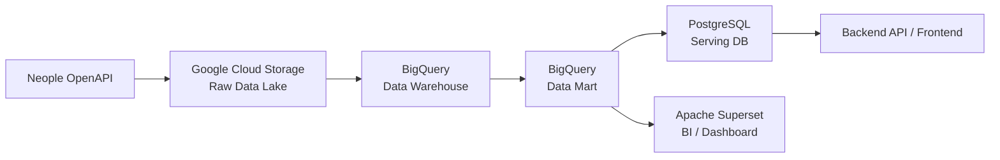

# [던통] 게임 통계 서비스 - 4. 데이터 플랫폼 구축: DL, DW, DM

## 0️⃣ 프로젝트 개요

[[던통] 게임 통계 서비스 - 2. 데이터 플랫폼 구축: 데이터 파이프라인 만들기](/posts/projects/data-platform-data-pipeline)에서 작성한 데이터 파이프라인 구축은 기존 App DB에 존재하는 데이터를 최신화하고, 이를 집계하여 최신 통계 데이터를 보여주는 과정이었습니다.

이와 더불어 새로운 기능을 추가하여 다양한 서비스 지표를 제공하고자 했습니다. 현재 게임의 지표를 궁금해하는 유저가 많지만, 서비스 지표를 PC방 지표와 같이 간접적인 방법으로 확인하거나 인게임 내에서 체감하는 수준에서 그쳤습니다.

이러한 문제를 해결하기 위해 매일 업데이트 되는 던전앤파이터 서비스 지표를 보여주고자 Active User, Retention, Churn Rate 등 다양한 지표를 계산해야 했습니다. 이를 위해서는 매일 유저들의 인게임 활동 정보들을 수집해야 했습니다.

앞서 구축한 데이터 파이프라인과 비슷한 방식으로 OpenAPI를 활용해 매일 3백만 개의 캐릭터의 활동 데이터를 수집해야 했습니다. 하지만, 매일 몇천만건이 넘는 데이터를 App DB에 저장하는 것은 효율적이지 못했습니다. App DB에 저장한다고 해서 데이터를 매번 집계해서 서빙하는 것이 아니기 때문에 보다 효율적인 데이터 저장 및 분석을 위해 BigQuery와 같은 OLAP 분석용 데이터베이스를 활용했습니다.

하지만, 단순히 BigQuery에 데이터를 저장하는 것만으로는 효율적으로 데이터를 분석하기 어려웠습니다. 이번 포스팅에서는 데이터를 효율적으로 관리하고 확장성 있는 구조를 가져가기 위해 BigQuery에서 데이터 웨어하우스를 구축한 과정을 알아보겠습니다.

---

## 1️⃣ Medallion Architecture

### 1-1. 메달리온 아키텍처 도입 이전

던통 프로젝트를 수행하기 전에는 OpenAPI에서 가져온 데이터를 필요한 형태로 가공한 뒤 바로 저장하는 구조를 거쳤습니다. 하지만, 원본 데이터를 잘못 가공하는 경우 원본 API 응답을 저장하지 않았다면 과거 데이터를 복구하기 위해 외부 API를 다시 호출해야 합니다. 이러한 상황에서 데이터를 재수집하면 fetch 시점이 달라져서 데이터 신뢰성의 문제가 발생할 수 있습니다. 즉, 외부 API 데이터가 변경되었거나 과거 데이터를 사용할 수 없다면 동일한 데이터를 재현할 수 없습니다.

또한, 기존에는 대시보드 구축 시 데이터가 크지 않더라도 매번 집계를 진행해서 특정 대시보드에서 오랜 시간이 걸리는 문제가 발생했습니다. 이전 프로젝트에서는 RDBMS와 BI 서버가 서로 다른 리전에 존재하여 대시보드 진입 시 데이터 지연 문제가 발생하고, Superset DashBoard에서 복잡한 쿼리를 작성하여 데이터를 로딩했습니다.

이러한 경험 덕분에, 이번 프로젝트에서는 기존에 수집한 원본 데이터를 저장하고 이를 기반으로 데이터를 가공하고 재처리하는 구조로의 개선을 적용하기로 했습니다. 위 문제를 메달리온 아키텍처 도입하여 이를 기준으로 Data Lake, Data Warehouse, Data Mart를 분리했습니다. 이를 통해 데이터 안정성 및 신뢰도 증가, 데이터 재사용성 향상, BI에서 매번 집계가 필요없는 구조 등의 장점이 있기에 데이터를 효율적으로 다룰 수 있었습니다.

### 1-2. 메달리온 아키텍처 도입 이후

구조는 아래에 간단한 그래프를 통해서 나타내었습니다.



Airflow가 데이터 수집, 변환, 적재를 관리를 담당했습니다. Bronze Layer는 Data Lake로 사용하는 Google Cloud Storage를, Silver Layer는 Data Warehouse로 사용하는 BigQuery를, Gold Layer는 BigQuery와 Serving DB로 사용하는 PostgreSQL을 사용했습니다.

또한, 중간에 Staging Table을 사용하여 데이터를 임시로 저장하고, 데이터 변환 작업을 수행한 후에 Silver Layer로 적재하는 방식을 사용했습니다.

이러한 방식을 통해서 데이터를 체계적으로 관리할 수 있는 계층형 데이터 플랫폼을 구축했습니다.

---

## 2️⃣ Data Lake

Data Lake는 원본 데이터를 저장하는 계층으로, 원본을 다시 사용할 수 있도록 보존하기 위해 사용됩니다. Data Lake 없이 Airflow를 잠깐 운영했을 때, 원본 데이터를 저장하는 공간이 따로 마련되지 않아 데이터 저장 및 관리를 정상적으로 할 수 없었습니다. 백필 스크립트마다 원본 데이터를 관리하는 방식이 달랐고, GCS와 같은 버킷에 저장하는 방식도 달라서 데이터 추적이 어려운 문제가 발생했습니다.

### 2-1. 데이터 추적

이러한 문제를 해결하기 위해, 날짜와 shard 등을 기준으로 데이터를 저장했습니다. 대용량의 데이터를 한번에 fetch를 하기에 Chunk 단위로 데이터를 관리했고, 게임 서비스 특징 상 06시에 데이터가 초기화되어 service data라는 이름을 추가하여 저장했습니다.

```text
timeline/raw/daily/v1/
  season=cheonhaecheon/
    service_date=2026-08-01/
      fetch_shard=00000-of-00100/
        part-*.jsonl.gz
        manifest.json
      fetch_shard=00001-of-00100/
        part-*.jsonl.gz
        manifest.json
      ...
      manifest.json
```

데이터를 저장하지 않고 데이터를 재수집해야 하는 경우 API 호출량 제한 때문에 많은 시간이 소요되는 구조에서 특정 날짜의 BigQuery 적재가 실패하더라도 GCS의 Raw Data가 남아 있기 때문에 외부 API를 다시 호출하지 않고 동일한 원본을 이용해서 DW를 다시 생성할 수 있는 구조로 변경했습니다. 즉, Data Lake를 통해 재사용 가능한 구조로 변경했습니다.

### 2-2. Manifest로 데이터 수집 완료 여부 관리하기

Raw 데이터를 파일로 저장하는 것만으로는 충분하지 않았습니다. 예를 들어, 100개의 shard 중 97개만 정상적으로 저장된 상황에서 후속 BigQuery 적재가 시작되면 해당 날짜 데이터 전체가 정상적으로 수집된 것처럼 처리될 수 있습니다. 그래서 각 shard와 날짜 단위로 `manifest.json`을 생성하여 관리했습니다.

Manifest에는 다음과 같은 정보를 기록합니다.

- 처리한 `service_date`
- 전체 대상 수
- shard 수
- 저장된 object 목록
- payload record 수
- timeline row 수
- success / empty / missing / retryable error / hard failure 수
- 실행 시각

모든 shard가 완료된 경우에만 날짜 단위의 최종 manifest를 생성합니다.

```text
Shard 1 ─ 완료
 ...
Shard N ─ 완료
       ↓
Canonical Manifest 생성
       ↓
BigQuery Load 가능
```

따라서 downstream 파이프라인에서는 파일이 존재하는지를 확인하는 것이 아니라 해당 날짜의 수집이 완전히 끝났는지 확인하도록 했습니다.

---

## 3️⃣ Data Warehouse

### 3-1. 데이터 살펴보기

Raw API JSON을 그대로 분석에 사용하면 여러 문제가 있습니다.

- nested JSON 파싱이 반복됨
- 이벤트별 schema가 다름
- 중복 데이터 처리 기준이 없음
- 날짜 계산을 모든 SQL에서 반복함
- 동일한 데이터인데 분석가마다 다른 조건으로 처리할 수 있음

따라서 Raw 데이터를 분석 가능한 데이터 웨어하우스를 구축하는 것이 중요합니다.

서비스 지표를 분석하기 위해서는 캐릭터의 활동 정보를 얻어야 하고, 이를 위해서는 OpenAPI에서 Timeline 데이터를 수집해야합니다. Timeline은 캐릭터의 활동 정보를 담고 있으며, 캐릭터의 활동에 따라서 코드로 구분되어 있습니다.

Timeline 데이터는 활동 유형에 따라 다음과 같이 아이템 획득, 아이템 업그레이드, 던전 클리어 3가지 큰 축으로 분리하여 데이터 웨어하우스를 구축하고자 했습니다.

```text
GCS Raw Timeline
        ↓
daily_timeline_fetch_presence
        ↓
├─ dw_timeline_dungeon_clear
├─ dw_timeline_item_acquisition
└─ dw_timeline_item_upgrade
```

<details class="orca-details">
<summary>활동 코드 전체 보기</summary>

| 코드  | 설명                   |
| ---: | -------------------- |
| 101 | 캐릭터 생성               |
| 102 | 캐릭터명 변경              |
| 103 | 캐릭터 전직               |
| 104 | 캐릭터 최고 레벨 달성         |
| 105 | 모험단명 변경              |
| 201 | 레이드                  |
| 202 | 비탄의 탑 정복             |
| 203 | 절망의 탑 정복             |
| 204 | (구) 마수 던전 토벌         |
| 205 | 제국투기장 하드모드 클리어       |
| 206 | 마수 던전 토벌             |
| 207 | 핀드워 클리어              |
| 208 | 무덤의 탑 정복             |
| 209 | 레기온 클리어              |
| 210 | 레이드(선발대)             |
| 301 | 결투장 경험치 등급 상승        |
| 401 | 아이템 강화               |
| 402 | 아이템 증폭               |
| 403 | 아이템 재련               |
| 404 | 아이템 개조               |
| 405 | 아이템 새김               |
| 406 | 아이템 계승               |
| 407 | 아이템 단조               |
| 501 | 봉인된 자물쇠 아이템 획득       |
| 502 | 레전더리 획득              |
| 503 | 에컨 레전더리 획득           |
| 504 | 아이템 획득(항아리 &amp; 상자) |
| 505 | 아이템 획득(던전 드랍)        |
| 506 | 아이템 획득(조각 교환)        |
| 507 | 아이템 획득(레이드 카드 보상)    |
| 508 | 아이템 획득(상점)           |
| 509 | 아이템 초월 전송(NPC)       |
| 510 | 아이템 교환               |
| 511 | 아이템 획득(업그레이드)        |
| 512 | 권능                   |
| 513 | 아이템 획득(던전 카드 보상)     |
| 514 | 아이템 획득(제작서)          |
| 515 | 아이템 초월 수령(NPC)       |
| 516 | 아이템 초월(초월의 돌)        |
| 517 | 아이템 융합 분리            |
| 518 | 특수 아이템 획득            |
| 519 | 아이템 변환               |
| 520 | 아이템 획득(장비 제작)        |
| 521 | 아이템 획득(레이드 경매 보상)    |
| 550 | 서약 획득(던전 드랍)         |
| 551 | 서약 획득(레이드 카드 보상)     |
| 552 | 서약 획득(항아리 &amp; 상자)  |
| 553 | 서약 획득(업그레이드)         |
| 554 | 서약 획득(제작서)           |
| 555 | 서약 획득(무기고)           |
| 556 | 서약 초월(초월의 돌)         |
| 557 | 서약 획득(던전 카드 보상)      |
| 601 | 룬 획득                 |
| 602 | 탈리스만 획득              |

</details>

3가지 큰 축의 데이터는 다음과 같이 생겼습니다.

[tabs: 기본 정보, 아이템 업그레이드, 아이템 획득, 던전 클리어]

```json
{
  "serverId":  "cain",
  "characterId":  "6f193b71000d61d29b28214fecf27551",
  "characterName":  "베짱이28호",
  "level":  115,
  "jobId":  "a5ccbaf5538981c6ef99b236c0a60b73",
  "jobGrowId":  "618326026de1a1f1cfba5dbd0b8396e7",
  "jobName":  "마법사(남)",
  "jobGrowName":  "眞 빙결사",
  "fame":  108033,
  "adventureName":  "햄악귀",
  "guildId":  "86811731020a011fdcd8d0ba246d64bd",
  "guildName":  "초이스"
}
```

```json
{
    기본정보
    "timeline":  {
                     "date":  {
                                  "start":  "2025-04-15 00:00",
                                  "end":  "2026-04-14 23:59"
                              },
                     "next":  "f7dd600edcc7d8fbb16e150085cd89b1c64308607fe79a28de3b67571ee43d199c4cc97ee4505469cf3b27bc8551d645460899be5686295f2c30cf331ac3f75e3035a3cac26ea861e648c233b9c122fd8fac6c8ae680691a8aa5a6476033949e",
                     "rows":  [
                                  {
                                      "code":  402,
                                      "name":  "아이템 증폭",
                                      "date":  "2025-07-05 16:28",
                                      "data":  {
                                                   "itemId":  "17e1cababa951470969dbba4e9bb8547",
                                                   "itemName":  "화려한 황금향의 영광 - 팔찌",
                                                   "itemRarity":  "레전더리",
                                                   "before":  10,
                                                   "after":  11,
                                                   "result":  false,
                                                   "safe":  false
                                               }
                                  }
                              ]
                 }
}
```

```json
{
    기본정보
    "timeline":  {
                     "date":  {
                                  "start":  "2026-03-15 02:25",
                                  "end":  "2026-04-14 02:25"
                              },
                     "next":  "86314aa12d9e801cd4a5f1b4ecab6e209161382d59e594c21b22725ce49aedf42fd501ab553bb618c735a87e32e42991dde7f597ad7ddab80d88c7fd0949204666a9b7f760586c84fd9985755179506c156a7ef58100f63a9f47592aa0241dcd56d13c4ce8677fa39a2edbc2f5d92bda8c919590664dce97fbfc446052229f06cb6a5307343a10f599d4ccc77530fb9739074d9f414ab7a2ab1dbd0fc6ea876905c39703b7332e41040207aff4d3e9321c7af31fdd3c03f88e55dc173247c18b",
                     "rows":  [
                                  {
                                      "code":  505,
                                      "name":  "아이템 획득(던전 드랍)",
                                      "date":  "2026-04-13 13:06",
                                      "data":  {
                                                   "itemId":  "84d5b02fb7ae89f051a82e8d0b390f48",
                                                   "itemName":  "용의 공포를 심는 포효",
                                                   "itemRarity":  "레전더리",
                                                   "channelName":  "천해천",
                                                   "channelNo":  59,
                                                   "dungeonName":  "최후의 조율자",
                                                   "mistGear":  false
                                               }
                                  }
                              ]
                 }
}
```

```json
{
    기본정보
    "timeline":  {
                     "date":  {
                                  "start":  "2026-03-15 02:25",
                                  "end":  "2026-04-14 02:25"
                              },
                     "next":  null,
                     "rows":  [
                                  {
                                      "code":  201,
                                      "name":  "레이드",
                                      "date":  "2026-04-08 22:11",
                                      "data":  {
                                                   "raidName":  "만들어진 신 나벨",
                                                   "raidPartyName":  "하드  대충 갑시다",
                                                   "modeName":  "무지의 악",
                                                   "hard":  true
                                               }
                                  }
                              ]
                 }
}
```

[/tabs]

캐릭터를 식별할 수 있는 `기본정보 + 아이템 업그레이드/아이템 획득/던전 클리어`의 형태로 입력이 들어오는 것을 확인할 수 있습니다. 여기서 Grain을 어떻게 정의할 것인지를 생각해야합니다.

### 3-2. Data Warehouse 설계


Grain은 테이블의 한 행이 무엇을 의미하는지를 정하는 기준입니다. 
Timeline 데이터는 목적에 따라 3개 테이블로 분리했고, 각각 Grain을 다음과 같이 정의했습니다.


| 테이블                            | Grain                |
| ------------------------------ | -------------------- |
| `dw_timeline_dungeon_clear`    | 한 캐릭터의 던전 클리어 이벤트 1건 |
| `dw_timeline_item_acquisition` | 한 캐릭터의 아이템 획득 이벤트 1건 |
| `dw_timeline_item_upgrade`     | 한 캐릭터의 강화 시도 1건      |


식별자는 이름이 아닌 안정적인 키를 기준으로 정했습니다.

- 캐릭터: `serverId + characterId` (이름은 변경 가능하므로 식별자로 사용하지 않음)
- 모험단/길드도 마찬가지로 이름이 아닌 내부 key로 연결

다만 이벤트 테이블에는 발생 당시의 캐릭터 명성·직업·길드 상태를 고정 저장하지 않기 때문에, 
과거 시점 캐릭터 상태까지 분석하려면 별도의 일별 snapshot이나 이력형 Dimension이 추가로 필요합니다.

<br/>

### 3-3. 파티셔닝 &amp; 클러스터링

PostgreSQL과 같은 RDB에서는 인덱스를 통해 데이터를 효율적으로 조회했다면, BigQuery와 같은 분산 데이터 웨어하우스에서는 파티셔닝과 클러스터링을 통해 데이터를 효율적으로 조회할 수 있습니다.

파티셔닝은 데이터를 논리적으로 분할하여 조회 성능을 향상시키는 방법입니다. BigQuery와 같은 대용량 OLAP의 경우에는 날짜를 기준으로 파티셔닝하여 전체 테이블을 스캔하지 않고 해당 파티션만 조회하여 스캔 비용을 절약할 수 있습니다.

클러스터링은 파티션 내부(또는 전체 테이블)의 블록 단위 스토리지 내에서 데이터를 특정 컬럼 순서대로 정렬하여 묶어두는 방식입니다. 쿼리 실행 시 각 블록의 메타데이터를 확인하여 일치하지 않는 블록을 건너뛰는 '블록 프루닝'을 통해 데이터를 빠르게 조회할 수 있습니다.

클러스터링 컬럼은 최대 4개까지 설정 가능하며 내부적으로는 계층적으로 동작하기에 적절한 첫번째 클러스터링 컬럼을 설정하는 것이 중요합니다.

'service_date'로 파티셔닝을 진행 후, 어떤 유형의 이벤트인지 나타내주는 'event_code'와 유저를 나타내는 'character_id' 등을 기본적으로 설정하여 쿼리 사용시 속도를 높일 수 있습니다.


---

## 4️⃣ Data Mart

파티셔닝과 클러스터링을 통해 원천 데이터 스캔을 최적화했더라도, 로그 테이블 특성상 누적 용량이 수십~수백 GB에 달해 매 분석 쿼리마다 직접 조회하는 것은 여전히 큰 스캔 비용과 쿼리 지연을 유발합니다. 특히 대시보드나 비즈니스 분석에서는 특정 기준(일자, 콘텐츠, 유저 세그먼트 등)으로 요약된 지표를 조회하는 경우가 대부분입니다. 이에 따라 분석 목적에 맞춰 필요한 데이터를 미리 집계해 둔 데이터 마트를 구축했습니다.


### 1. 데이터 마트 설계

데이터 마트 구현 시 **Intermediate table를** 방지하고 일관된 지표 산출을 위해 Grain을 명확히하는 것이 중요합니다.

예를 들어, **인게임 아이템 획득 일간 집계 마트의 Grain은** `일자(service_date) × 이벤트 유형(event_code)` 으로 설정하여 일별 아이템 획득량 추세를 확인할 수 있습니다. 또한, 인게임 일간 집계 던전 클리어 마트의 Grain은 `일자(service_date) x dungeon_key(던전 식별자) x 난이도(difficulty)` 등으로 설정하여 해당 날짜에 난이도에 따른 던전 클리어 횟수 정보를 확인할 수 있습니다.

매 시즌 캐릭터 전투력 스케일링을 통해 던전의 입장 명성 정보 등이 바뀌므로 과거 로그를 수정하지 않고 차원 테이블(`dim_dungeon`)만 갱신할 수 있도록 스타 스키마 구조로 분리 설계했습니다.


### 2. 계층적 집계 (Hierarchical Aggregation / Roll-up)

데이터 웨어하우스를 매번 전체 스캔하여 지표를 산출하는 것은 막대한 비용과 쿼리 지연을 초래합니다. 이를 최적화하기 위해 시간 축(Temporal)과 **엔티티 축(Entity)** 두 가지 차원에서 단계별 계층적 집계 구조를 설계했습니다.

1. **시간 단위 계층화 (이벤트 로그 -&gt; 일간 -&gt; 주간):**

- 수억 건의 원천 로그 대신 이미 정제된 **일간 집계 마트를 기반으로 주간 마트를 집계**했습니다.
- 이를 통해 주간 지표 산출 시 전수 스캔하는 비효율을 제거하고 배치 파이프라인의 연산 비용과 실행 시간을 단축했습니다.
- 또한 동일 일간 데이터를 기반으로 상위 기간 지표를 집계함으로써, 기간 간 지표 불일치 문제를 방지하고 정합성을 높였습니다.

2. **엔티티 단위 계층화 (이벤트 로그 → 캐릭터 → 계정/유저):**

- 한 유저가 여러 캐릭터를 육성하는 게임 환경 특성을 반영하여, `원천 로그(트랜잭션) → 캐릭터별 활동 집계 → 유저(계정) 통합 지표` 순으로 상향식 집계 파이프라인을 구축했습니다.
- 캐릭터별 행동 패턴(아이템 획득, 던전 클리어 등)과 계정별 지표(플레이 시간대, 플레이 타임 등)를 각각의 그레인에 맞춰 계층화하여 용도에 맞는 마트를 즉시 활용할 수 있도록 했습니다.

3. **지표 성격에 따른 가법성(Additivity) 관리:**

- 던전 클리어 수, 아이템 획득량 수 등 단순 합산이 가능한 **가법적 지표**는 하위 마트를 집계하여 연산 비용을 줄였습니다.
- 반면 Active User와 같은 **비가법적 지표**는 단순 합산 시 중복이 발생하기에 별도의 테이블로 분리하여 데이터 정합성을 보장했습니다.


## 5️⃣ 회고

이전에는 필요한 기능이 생길 때마다 데이터를 가공하고 저장소에 저장하는 방식으로 파이프라인을 구성했습니다. 하지만 데이터 규모가 커지고 다양한 분석 요구사항이 생기자 데이터 유실, 지표 불일치 등의 문제가 발생했습니다.

이번 데이터 플랫폼을 설게하며 '메달리온 아키텍처'와 구성하며 Kimball 방식을 기반으로 목적에 맞게 단계적으로 구성하는 것이 **시스템 전체의 문제를 줄여주는 안전장치가 될 수 있다는 것을** 체감했습니다. 특히, 이번 설계를 통해 **Kimball의 모델링**을 바탕으로 설계하며 데이터 모델링의 특징을 직접 경험할 수 있다는 점이 좋았습니다.


예를 들어, 

- **Data Lake (Bronze):** OpenAPI 원천 데이터를 그대로 보존하고 Manifest를 바탕으로 외부 API 장애나 적재 오류 시에도 문제를 해결할 수 있도록 했습니다.
- **Data Warehouse (Silver):** 이벤트 단위로 팩트 테이블을 분리하고 Grain을 정의하여 테이블을 구성했습니다. 또한, 잦은 메타 정보는 `dim_dungeon`과 같은 스타 스키마로 설정하여 과거 로그를 훼손하지 않는 데이터 모델을 구축했습니다.
- **Data Mart (Gold):** 대용량 DW를 매번 전수 스캔하지 않도록 시간, 엔티티를 바탕으로 계층적 롤업을 적용했습니다. 

결국 좋은 데이터 플랫폼이란 각 계층에 명확한 역할을 부여하고, 사용자가 최소한의 비용과 지연으로 신뢰할 수 있는 데이터를 사용할 수 있는 공간을 만드는 것임을 체감했습니다.